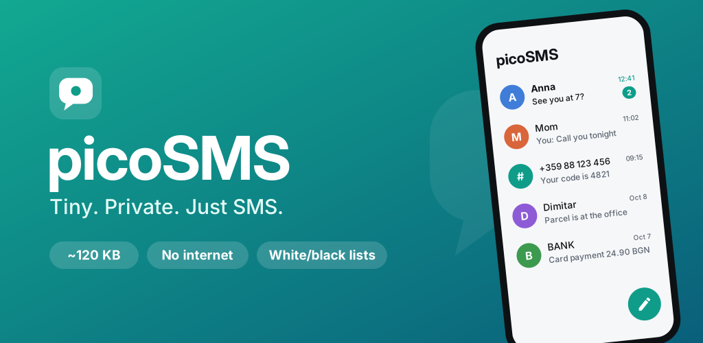

<p align="center">
  
</p>

# picoSMS

**Tiny. Private. Just SMS.**

picoSMS is an ultralight SMS app for Android. The whole release APK is about **120 KB**. It is built only on the Android framework and the Kotlin standard library: no AndroidX, no Google Play Services, no analytics, no ads. The app doesn't request the `INTERNET` permission at all.

## Features

- **Default SMS app.** Receives, sends and stores SMS in the system message store, so other apps and backups keep working.
- **Conversations.** Thread list with unread badges and contact names, plus a chat view with message bubbles, send status (sending / failed) and a live character/part counter.
- **Compose anywhere.** Handles `sms:` / `smsto:` links, "Share → picoSMS" for text, and the contact picker. You can send to several recipients at once (separate them with `,` or `;`).
- **Notifications with quick actions.** Reply inline or mark as read straight from the notification.
- **Quick replies from calls.** You can use "Respond via message" on the incoming-call screen.
- **Pick OTP Code.** picoSMS spots one-time codes ("Your code is 482193", "Код за вход: 5521", "G-731045") and puts a **Copy 482193** button on the notification a tap-to-copy chip with the code under the message, and a copy chip on the right side of the conversation row on the main screen (this chip also shows values from your own pickers). Times, dates, amounts and phone numbers are ignored. The code is copied as sensitive, so Android 13+ hides it in the clipboard preview.
- **Quick pick with regex.** You can add your own regular expressions ("pickers") to pull values out of messages the app doesn't parse by itself, such as tracking numbers, amounts, links or IBANs. Picked values show as copy chips in the chat, and the first one also appears on the right of the conversation row on the main screen. Each picker has an on/off checkbox and can be edited. While you type, a live preview shows exactly what the regex picks from your recent messages. Presets are included, and long-pressing a message offers **Create picker from this message**.
- **White/black list rules.** Each rule has:
  1. **Sender mode:** Contains, Equals, Starts with, Ends with, Regexp or Wildcard.
  2. **Senders:** a text area with one sender per line (commas also work).
  3. **Case sensitive:** a checkbox that applies to the whole rule.
  4. **…or add from contacts:** opens the contact picker and appends the number.
  5. **Text (+):** adds a message-text condition.
  6. **Text mode:** the same six modes.
  7. **Text entries:** each in its own field, with a × to remove it.

  Fill in the sender, the text, or both (then both must match). Any line of a list may match. In Equals mode, phone numbers match across formats (`+359881234567` = `0881234567`). In Wildcard mode, `*` means any text and `?` one character. Every rule has an **on/off checkbox** in the list, so you can pause it without deleting it.
  - **Whitelist mode** blocks everyone who isn't on the whitelist. Contacts can optionally always get through.
  - A whitelist rule always wins over a blacklist rule.
  - **Live preview with real examples.** While you edit a rule, the dialog shows how many of your existing messages it affects, with examples and the matching text highlighted.
  - **Apply rule** saves the rule and also applies it to messages you already have: a blacklist rule moves matching inbox messages into quarantine, and a whitelist rule restores matching quarantined messages. **Save** applies the rule to new messages only. Tap a rule to edit it, apply it later, or delete it.
  - Blocked messages are kept in a local **quarantine**, outside your inbox. From there you can restore them, delete them, or always allow that sender.
- **Labels (folders).** Group conversations by **sender** (numbers, sender names, `BANK*`, `/regex/`), by **words in any message** of the conversation, or by both. With both filled in, a switch decides whether a conversation must match both or either one. A chip bar on the main screen (**Inbox**, then each label with its unread count) filters the list. Turn on **Hide from Inbox** for a label, such as banks, shops or delivery services, and its conversations leave the main list and appear only under that label's chip. Notifications still arrive as usual. Long-press a chip to edit or delete the label, or long-press a conversation and choose **Add sender to label**. A live preview shows which conversations a label will contain while you edit it. Labels only group conversations; they never move or delete messages.
- **Back up and restore messages.** Use **Settings → Backup → Back up messages** to save all SMS to a file you choose, in one of two formats:
  - **XML**, compatible with *SMS Backup & Restore*, so you can move between the two apps in either direction.
  - **JSON**, picoSMS's own clean format.

  An optional **password** encrypts the file with AES-256-GCM, using a key derived with PBKDF2 (310,000 rounds of SHA-256 on Android 8+, 720,000 rounds of SHA-1 on Android 7), and compresses it. A wrong password or a modified file is detected and rejected. **Restore** detects the format and encryption by itself, skips messages already on the phone (so restoring twice adds nothing), and skips MMS entries. Large backups are read and written as a stream, so they never have to fit in memory. Restoring requires picoSMS to be the default SMS app. Saved "outbox"/"queued" messages come back as "not sent", so nothing is re-sent by accident.
- **Export / import settings.** Settings → Backup → Export settings saves your rules, labels, Quick pick regexes and switches as a readable JSON file, wherever you choose (local storage, a USB drive, any cloud app's document provider). Import shows what's in the file and lets you **Replace** your current settings or **Add** to them (duplicates are skipped). Messages and the blocked quarantine are never included.
- **Home screen widget.** A header-less list of the four latest conversations. When the latest message in a conversation is a one-time code, its row gets a compact **copy** chip on the right, so you can copy the code without opening the app. Tap a row to open the chat, or empty space to open the app. It is resizable and follows dark mode.
- **Tidy layout.** The main screen shows only conversations, the label chips and a ⚙ **Settings** button. Settings has tabs:
  - **Filters:** rules, whitelist mode, contacts switch.
  - **Blocked:** the quarantine.
  - **Quick pick:** OTP detection and your regex pickers.
  - **Backup:** message backup/restore and settings export/import.
  - **About:** version, set as default SMS app, source code, privacy policy.
- **Light and dark themes** follow the system setting. The app draws edge-to-edge on Android 15+.

### Not supported

- **MMS.** picoSMS has to declare an MMS receiver to qualify as the default SMS app, but it doesn't download or display MMS. When one arrives, you get a notification saying it can't be shown. Backups contain SMS only, and MMS entries in imported files are skipped.
- **Picking a SIM on dual-SIM phones.** Messages go out through the system's default SMS SIM.
- **RCS / chat features.**

## How filtering decides

For each incoming SMS, picoSMS checks these in order (paused rules are skipped):

1. Does any **whitelist** rule match? If so, the message is delivered.
2. Does any **blacklist** rule match? If so, it goes to quarantine.
3. Is **whitelist mode** on? If so, it goes to quarantine, unless "Always allow contacts" is on and the sender is a saved contact.
4. Otherwise the message is delivered.

A rule matches when its sender condition (if any) **and** its text condition (if any) both match. Within a condition, any entry may match.

## Building

Requirements: JDK 17+ and an Android SDK with platform 36.

```bash
./gradlew assembleRelease        # app/build/outputs/apk/release/
./gradlew bundleRelease          # app/build/outputs/bundle/release/ (for Google Play)
```

Release builds use **R8 in full mode** with code and resource shrinking (`isMinifyEnabled`, `isShrinkResources`). Other size settings:

- `-repackageclasses` and `-allowaccessmodification`
- Kotlin runtime assertions are stripped (`-Xno-*-assertions` plus `assumenosideeffects` on `Intrinsics.check*`)
- Locale filtering keeps only `en` resources
- Kotlin metadata and dependency info are excluded from the APK
- Regex uses `java.util.regex` directly rather than Kotlin's `Regex` and sequence wrappers, which cuts Kotlin library code to about 6 KB
- The Android 7 launcher icon is a vector, so the APK carries no PNGs (Android 8+ uses the adaptive icon)

### Signing

Create a `keystore.properties` file in the project root (it's git-ignored):

```properties
storeFile=release.jks
storePassword=...
keyAlias=picosms
keyPassword=...
```

Without that file the release APK is built unsigned.

## Project layout

```
app/src/main/java/x/vladgba/sms/
  MainActivity.kt     conversation list, label chips, default-app and permission requests
  SettingsActivity.kt settings screen with tabs; Page.kt is the base class of each tab
  BackupPage.kt       Backup tab (message backup/restore, settings export/import)
  AboutPage.kt        About tab
  ThreadActivity.kt   chat view + compose (sms:/smsto: links, share, contact picker)
  RulesPage.kt        Filters tab: white/black list rules, live preview, apply to existing messages
  PickersPage.kt      Quick pick tab: OTP switch + regex pickers with live preview
  Apply.kt            preview/apply a rule against existing messages
  Labels.kt           label (folder) matching by sender and/or words
  Picks.kt            OTP detection, regex pickers, clipboard copy
  Backup.kt           settings export/import (JSON)
  SmsBackup.kt        SMS backup/restore against the system message store
  SmsFormats.kt       streaming XML (SMS Backup & Restore) and JSON readers/writers, AES-GCM encryption
  BlockedPage.kt      Blocked tab: quarantine for blocked messages
  Receivers.kt        SMS_DELIVER, WAP_PUSH (MMS stub), sent status, notification actions,
                      HeadlessSmsSendService (respond via message)
  Sms.kt              wrapper around the system SMS provider
  Sender.kt           SmsManager sending (multipart, status tracking)
  Rules.kt            filter engine
  Db.kt               app-private SQLite: rules + quarantine
  Notifier.kt         notifications with reply / mark-read actions
  Widget.kt           home screen widget
  Contacts.kt         number → contact name lookup (cached)
  Ui.kt               background executor, edge-to-edge insets, formatting
store/                Play Store icon (512×512) and feature graphic (1024×500), with SVG sources
```

## Google Play notes

- The app uses the SMS permission group. Google Play only allows that for apps whose core function is being the **default SMS handler**, which is picoSMS's case. Declare "Default SMS handler" in the Permissions Declaration Form.
- Store assets are in [`store/`](store/), and the privacy policy is [PRIVACY.md](PRIVACY.md).

## Privacy

picoSMS has no network access, and it collects and shares nothing. See [PRIVACY.md](PRIVACY.md).

## License

[MIT](LICENSE) © 2026 vladgba
